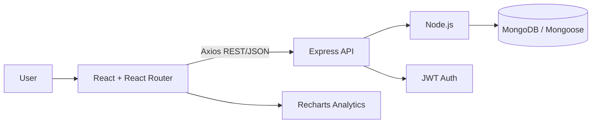

# Architecture

## Core entities

- **User** → authentication and role
- **PollutionReport** → incident source, severity, coordinates and response status
- **WaterQuality** → station measurements and quality status
- **CleanupActivity** → field operations and recovered material
- **EnvironmentalIndicator** → target-based environmental trends

## Recommended future additions

- Map visualization using Leaflet/OpenStreetMap
- Image/file upload for field evidence
- Email alerts for critical incidents
- CSV import/export for research datasets
- Scheduled water-quality reminders
- Public read-only transparency portal
